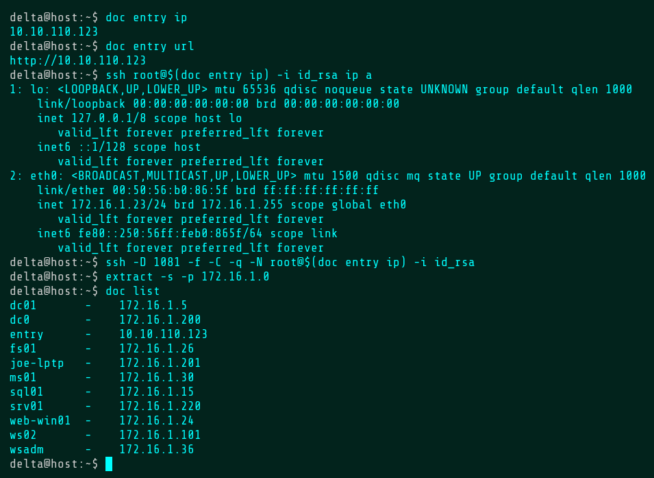
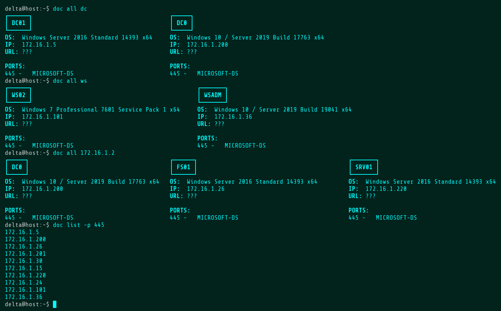
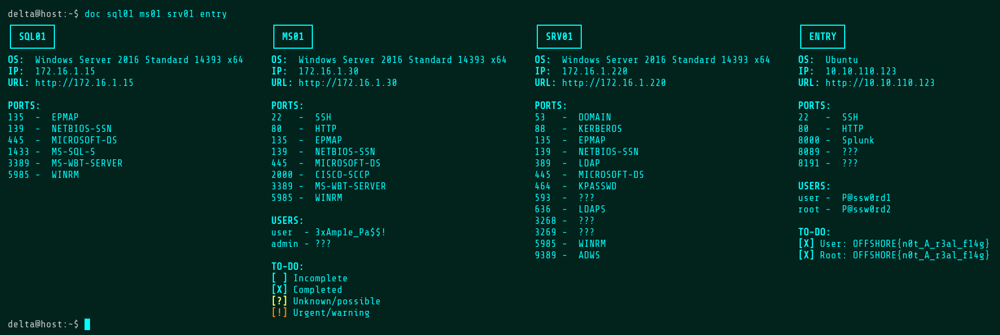

# DOC  
Documentation, Of Course!  
  
A tool for automatically organizing and searching for host info when doing pentests or CTFs.  
With doc, you'll always know what's up!  
  
<b>Highlights:</b>  
• Search by hostname/alias, IP, or port.  
• Automatically formats host info into neat little cards. Pretty!  
• Useful for automation:  
  • Why remember and type a whole address when you can just do `$(doc [name] ip)` or `$(doc [name] url)`?  
  • Scan all hosts with a certain port like so: `for x in $(doc list -p [port number]); do [command] "$x"; done`  
• Scripts for ingesting nmap and nxc output included.  
• Extensible - Just add JSON!  
• Easily editable per-host to-do lists with built-in color coding.  
• Optional GPG integration. (Work-in-progress. Might use `pass`...)  
  
<b>Installation:</b>  
Run `sudo apt-get install -y rg sd jq`  
That should cover most functionality.  
  
## Usage  
<b>Actions</b>  
`doc [host name(s)]`: Print info cards for the provided hosts.  
`doc all`: Print all host cards at once! (Work-in-progress. Needs formatting.)  
`doc all [text]`: Print host cards whose names or IPs include the provided text.  
`doc list`: List the names and IPs of all hosts.  
`doc list names`: List the names of all hosts.  
`doc list ips`: List the IPs of all hosts.  
`doc list -p [port]`: List the IPs of all hosts with a certain port.  
`doc clear`: Clear the card cache. Useful if editing host JSON directly.  
`doc target [name]`: Define a particular host as the current target for `doc x`.  
`doc x [...]`: Useful for scripting. If another script uses `doc x`, you can set targets for it dynamically.  
`doc conf`: Display doc's current settings.  
`doc conf [setting] [value]`: Edit doc's settings. (Work-in-progress.)  
  
<b>Updating Host Info</b>  
New host cards are created using `doc -c [name]`.  
In general, hosts are updated using the syntax `doc -u [name] [field] [value]`.  

Update ports:
`doc -u [name] ports [number]`  
If possible, the most likely service for that port will be added automatically.  
The "os", "ip", and "url" fields can be updated similarly.  
  
Update users:  
`doc -u [name] users [username]`  
  
Update passwords:  
`doc -u [name] users [username] [password]`  
If you want to add production credentials, please consider running `doc conf gpg true`.  
This forces doc to use GPG when storing or retrieving host info.  
  
Update to-do list:  
`doc -u [name] todo`  
This will open the text editor defined by the `$EDITOR` environment variable.  
After that, you can add a list like the one shown below.  
```
[ ] Incomplete
[X] Completed
[?] Unknown/possible
[!] Urgent/warning
```
  
## Examples  
The following examples will use a HackTheBox lab environment with user and flag data replaced by sample text.  
  
The "extract" script provides examples of automatic data extraction/ingestion using Nmap and NetExec.  
`extract -n [IP] [name]` will create a basic info card using results from nmap.  

  
Observe how `$(doc [name] ip)` can be used in place of addresses.  
If you have access to a bastion host like this one, you can use `extract -s -p [network address]` to scan for Windows hosts on the internal network via SMB.  
The `-p` flag uses proxychains to allow NetExec to reach the LAN. This will create host cards that includes the IP, OS version, and hostname of machines on the specified network.  

  
The cards can now be searched by name and IP.  
`doc list -p 445` will return all SMB-capable IPs for use in further scans.  

  
Examples of host cards including various fields.  
Note the automatic color-coding of the to-do list based on the presence of "?" or "!" in the checkbox.  

